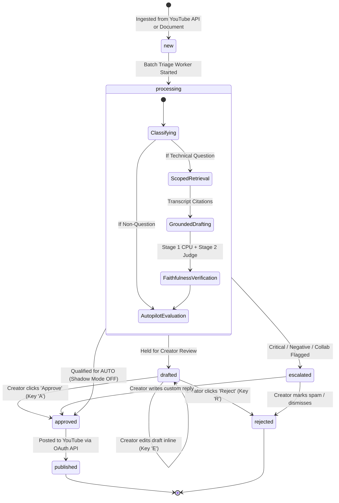

# 🎬 CommentIQ: Human-Supervised YouTube Comment Triage Agent

[](https://www.python.org/downloads/)
[](https://nextjs.org/)
[](https://fastapi.tiangolo.com/)
[](https://github.com/pgvector/pgvector)
[](https://langchain-ai.github.io/langgraph/)
[-brightgreen.svg?style=flat-square)](#-the-0-budget-strategy)
[](#-running-tests)
[](https://opensource.org/licenses/MIT)

A human-supervised, safety-first autonomous AI agent and editorial creator studio designed to triage YouTube comments at scale. It answers technical questions **strictly** when grounded in video transcripts with `[MM:SS]` timestamp citations, eliminates hallucinations via multi-stage verification, and deterministically routes every comment through a **Granular Autopilot Rules Engine**:

* 🟢 **`AUTO`**: Automated replies for short praise and verified technical FAQs (safely gated behind a persistent **Shadow Mode** switch).
* 🔵 **`DRAFT`**: Held in a keyboard-driven review queue (`J/K`, `A`, `E`, `R`) for one-click creator approval or inline editing.
* 🟠 **`ESCALATE`**: Flagged instantly for creator attention (Viewer complaints, sponsorship/business collabs, bug reports, and safety/crisis issues).

Built on a permanent **$0 budget** using free-tier LLMs (Groq, Mistral, Ollama), local CPU embeddings (`sentence-transformers/all-MiniLM-L6-v2`), local BM25 lexical search, and open-source infrastructure.

---

## 🗺️ Visual Architecture & Workflows

### 1. High-Level End-to-End Architecture
```mermaid
flowchart TD
    subgraph INGEST["1. Ingestion & Scoped Workspace"]
        A1["YouTube URL / Video ID"] --> B1["2-Tier Transcriber<br/>(Captions ➔ Groq Whisper)"]
        A2["Comments File<br/>(PDF / DOCX / CSV / JSON)"] --> B2["Document Comments Parser"]
        B1 --> C1[("Transcript Chunks<br/>[MM:SS] Timestamps")]
        B2 --> C2[("Queued Comments")]
    end

    subgraph WORKSPACE["Target Video Workspace"]
        C1 --> WS["Scoped List Workspace<br/>(e.g., 'Masterclass Video #1')"]
        C2 --> WS
    end

    subgraph TRIAGE["2. LangGraph Agent Pipeline"]
        WS --> D["Classifier Node<br/>(Groq Llama 3.3 70B / 20B)"]
        D -->|Questions & Inquiries| E["Hybrid Retriever<br/>Dense 384d + BM25 Lexical"]
        D -->|Praise / Collab / Spam / Complaint| R["Granular Autopilot Rules Engine"]
        E --> F["Grounded Drafter Node<br/>(Enforces [MM:SS] Citations)"]
        F --> G{"Is Draft ABSTAIN?"}
        G -->|Yes (Unsupported)| R
        G -->|No| H["Two-Stage Faithfulness Verifier"]
        H -->|Stage 1: Local CPU Overlap| I{"Overlap Pass?"}
        I -->|Pass / Fail Fast| R
        I -->|Borderline| J["Stage 2: LLM Judge<br/>(Mistral Large-4)"]
        J --> R
    end

    subgraph SAFETY["3. Safety & Autopilot Rules Engine"]
        R --> K{"Rule Evaluation"}
        K -->|Sensitive Override| ESC["ESCALATE<br/>(Flagged to Creator)"]
        K -->|Negative Keyword Match| ESC
        K -->|Low Confidence / Abstain| DRF["DRAFT<br/>(Review Queue)"]
        K -->|Verified Pass| AUT{"Shadow Mode Active?"}
        AUT -->|Yes (Default Safety)| DRF
        AUT -->|No| PUB["AUTO<br/>(Live Auto-Publish)"]
    end

    subgraph STUDIO["4. Linear-Grade Creator Studio (Next.js 14)"]
        DRF --> UI["Editorial Review Queue<br/>(40-48px rows, J/K nav, Cmd+K)"]
        ESC --> UI
        PUB --> UI
        UI -->|Ask AI Guidance| ASK["Ask AI Assistant<br/>(De-escalation notices)"]
        UI -->|One-Click Approve / Edit / Reject| AUD[("Immutable Audit Log")]
    end
```

---

### 2. Two-Tier YouTube Ingestion & Hybrid RAG Engine
```mermaid
flowchart LR
    URL["YouTube URL / ID"] --> CHECK{"Closed Captions<br/>Available?"}
    
    CHECK -->|Yes (Tier 1: $0)| TIER1["youtube-transcript-api<br/>Instant Fetch in < 250ms"]
    CHECK -->|No (Tier 2: Fallback)| TIER2["yt-dlp Audio Stream ➔<br/>Groq Whisper Large-v3"]
    
    TIER1 --> FORMAT["Segment & Prepend Markers<br/>[04:12] 'In this tutorial...'"]
    TIER2 --> FORMAT
    
    FORMAT --> CHUNKER["Transcript Chunker<br/>(200-400 words per chunk)"]
    
    CHUNKER --> DENSE["Local CPU Dense Embedding<br/>all-MiniLM-L6-v2 (384d)"]
    CHUNKER --> BM25["BM25 Lexical Indexer<br/>(Exact technical keywords)"]
    
    DENSE --> RRF["Reciprocal Rank Fusion (RRF)<br/>Score = 0.5 * Dense + 0.5 * BM25"]
    BM25 --> RRF
    
    RRF --> SCOPED[("Scoped Vector Store<br/>(Isolated strictly by video_id)")]
```

---

### 3. Granular Autopilot Decision Tree & Hard Safety Invariants
```mermaid
flowchart TD
    START(["Comment Enters Autopilot Router"]) --> SENSITIVE{"Category is 'sensitive'<br/>OR Crisis / Legal / Self-Harm?"}
    
    SENSITIVE -->|YES| ESC_SENS["🔴 ESCALATE<br/>Reason: 'Sensitive Content Guardrail'<br/>(Hard Invariant: CANNOT be bypassed)"]
    
    SENSITIVE -->|NO| SPAM{"Category is 'spam'<br/>OR Crypto / Link Farming?"}
    
    SPAM -->|YES| ESC_SPAM["🔴 ESCALATE<br/>Reason: 'Spam Suppression'<br/>(Hard Invariant: Zero automated reply)"]
    
    SPAM -->|NO| RULES["Evaluate Active Autopilot Rules<br/>(Ordered by Priority: #1 ➔ #4)"]
    
    RULES --> R1{"Rule #1: Negative Keywords<br/>('refund', 'scam', 'lawyer', 'broken')"}
    R1 -->|Matched| ESC_NEG["🔴 ESCALATE<br/>Reason: Matched high-risk keywords"]
    
    R1 -->|Pass| R2{"Rule #2: Collab / Complaint<br/>('business_collab', 'complaint')"}
    R2 -->|Matched| ESC_COLLAB["🔴 ESCALATE<br/>Reason: Creator personal attention needed"]
    
    R2 -->|Pass| R3{"Rule #3: Verified FAQ Draft<br/>Faithfulness ≥ 0.80 & Citations [MM:SS]"}
    R3 -->|Matched| DRAFT_FAQ["🔵 DRAFT<br/>Reason: Grounded technical draft queued"]
    
    R2 -->|Pass| R4{"Rule #4: Short Safe Praise<br/>Word count ≤ 25 & Conf ≥ 0.80"}
    R4 -->|Matched| AUTO_CHECK{"Is Shadow Mode Enabled?"}
    AUTO_CHECK -->|Yes (Default)| DRAFT_SHADOW["🔵 DRAFT<br/>Reason: Qualified for AUTO, held in Shadow Mode"]
    AUTO_CHECK -->|No| AUTO_PUB["🟢 AUTO<br/>Reason: Auto-reply armed"]
    
    R4 -->|No Rule Matched| FALLBACK["🔵 DRAFT<br/>Reason: Standard Baseline Review Queue"]
```

---

### 4. Comment Lifecycle State Machine


---

## ⚡ Key Capabilities & Implemented Batches

### 📦 Batch 1: YouTube URL Ingestion & Groq Whisper Fallback
* **Universal URL Ingestion**: Paste standard `youtube.com/watch?v=...`, `youtu.be/...`, shorts, embeds, or raw 11-character video IDs.
* **Instant oEmbed Metadata**: Fetches video titles and author info in `< 200ms` without API quotas.
* **Tier 1 (Instant, $0)**: Extracts official/auto-generated captions with timestamp markers via `youtube-transcript-api` (v1.2.5).
* **Tier 2 (Audio Fallback)**: If captions are disabled or unavailable, `yt-dlp` extracts the audio stream directly without local ffmpeg requirements, and transcribes via **Groq Whisper Large-v3** (`whisper-large-v3`, fast & $0 free tier).
* **Timestamp Grounding**: Formats chunks with `[MM:SS]` timestamp markers for Grounded RAG citations (e.g. `"[04:12] In this section we explain..."`).
* **Standalone Video Transcribe**: Ingest a video guide into a named list without uploading comments yet.

### 🛡️ Batch 2: Granular Autopilot Rules Engine & Live Simulator
* **Custom Multi-Condition Rules (`AutopilotRule`)**:
  * Category matching (e.g., `["praise", "question"]` or all categories)
  * Confidence threshold (e.g., `confidence >= 0.85`)
  * Faithfulness threshold (e.g., `faithfulness >= 0.80`)
  * Retrieval similarity score (e.g., `retrieval >= 0.35`)
  * Citation requirement (`[MM:SS]` or `[Page X]` citation must be present in draft)
  * Max comment word count constraint (e.g., `≤ 25 words`)
  * Negative keyword suppression (e.g. `refund`, `scam`, `broken`, `lawyer`, `urgent`)
  * Keyword triggers and VIP author substring matching
  * Priority ordering (`#1` to `#20`)
* **Live Dry-Run Simulator**: Test hypothetical comments in real time and see which rule matches, the resulting action, and full reasoning traces.
* **Factory Default Safety Rules**: Pre-seeded with 4 industry-standard safety rules that guarantee high-risk suppression and praise auto-replies.

### 🎭 Batch 3: Creator Persona Tone Cloner & Dynamic Few-Shot Drafter
* **Algorithmic Tone Fingerprinting**: Automatically extracts greeting habits (e.g. `Hey @author!`), sign-off signatures (e.g. `Hope this helps! 🚀`), formality level (casual / neutral / formal), emoji frequency, and sentence brevity from real comment replies.
* **One-Click Auto-Clone from Database**: Ingests previously approved and finalized replies directly from the database to clone the creator's true voice with zero prompt engineering.
* **Dynamic Few-Shot Ingestion**: Injects real approved `{comment, reply}` examples into the Drafter LLM prompt so drafts naturally mimic the creator's personality.
* **Grounding Preservation Invariant**: Facts and citations are strictly enforced from video transcripts (`[MM:SS]`); the persona shapes *voice and presentation*, while evidence strictly governs the *facts*.
* **Interactive Voice Sandbox**: Test-drive any persona preset on sample viewer queries in real time with live citation rendering.
* **Review Drawer Voice Pill**: The review drawer displays which persona drafted each reply (e.g. `Voice: Friendly Mentor`).

### 🗂️ Multi-List Triage & Video Workspaces
* **Named Workspaces**: Organize comments by video, course, or playlist (e.g. *"Video 1: Python Masterclass"*, *"Video 2: Docker Setup"*).
* **Independent RAG Knowledge Bases**: Each list maintains its own scoped transcript chunks and citations.
* **Sidebar Switcher**: Jump between workspaces or view the global aggregate queue with live count badges.

### 🤖 Ask AI Creator Assistant
* **Smart Creator Suggestions**: Click "Ask AI" inside any comment review drawer to generate grounded, context-aware sample replies.
* **Deterministic Sensitive Case Notices**: If a comment touches on safety, harassment, legal disputes, or crisis, the AI explicitly alerts the creator with de-escalation guidance.

### 🎨 Linear / Vercel Grade UI Redesign
* **Aesthetic**: Quiet, precise editorial styling with dark-first layered neutrals (5 surface levels, 1px subtle borders, zero template bloat).
* **Typography**: Geist UI pairing with Geist Mono for tabular numbers, timestamps, and citations.
* **Keyboard-Driven**: `J` / `K` for queue row navigation, `A` to Approve, `E` to Edit, `R` to Reject, and `Cmd+K` for global command palette.
* **Spring Animations**: Framer Motion drawer slides in smoothly with cited lines highlighted.

---

## 💰 The $0 Budget Strategy

CommentIQ is engineered from day one to operate on a permanent **$0 budget** using generous free-tier APIs and local CPU execution:

| Component | Free Tier Provider / Technology | Quota / Strategy |
| :--- | :--- | :--- |
| **Classifier** | Groq (`openai/gpt-oss-20b` or `llama-3.3-70b-versatile`) | Free tier (30 requests/min, 14,400/day) |
| **Drafter** | Groq (`openai/gpt-oss-120b` or `llama-3.3-70b-versatile`) | Free tier (30 requests/min) |
| **Verifier Judge** | Mistral (`mistral-large-4`) | Free tier (1 req/sec); Stage 1 CPU filters >60% |
| **Audio Transcription** | Groq Whisper Large-v3 (`whisper-large-v3`) | Free tier ($0 audio fallback for missing captions) |
| **Captions** | YouTube Transcript API | Free, unauthenticated direct caption extraction |
| **Local Embeddings** | `sentence-transformers/all-MiniLM-L6-v2` | Runs locally on CPU (~15ms per chunk); $0 cost |
| **Lexical Search** | `rank-bm25` | Runs locally in memory; exact keyword matching |
| **Vector DB** | PostgreSQL `pgvector` (or zero-setup SQLite) | Docker container or local zero-setup file |
| **Prompt Cache** | SHA-256 Hash Cache in Database | Eliminates duplicate token expenditures |

---

## 📊 Empirical Benchmark Results

Evaluated on 100 hand-crafted, production-realistic comments across **3 comparative baselines** (see [EVALUATION.md](file:///c:/Users/Vishal/Desktop/AI-Concept/AI_PROJECT/YT_Commentor/EVALUATION.md)):

### Hallucination Elimination on Unanswerable Questions
When viewers ask questions about topics not covered in the video (e.g. asking about AWS Lambda for a Docker tutorial):

| Architecture Baseline | Total Unanswerable Questions | Abstention Rate | Hallucination Count | Hallucination Rate |
| :--- | :---: | :---: | :---: | :---: |
| **Baseline A (Zero-Context LLM)** | 15 | 0.0% | 15 | 100.0% ❌ |
| **Baseline B (Naive Standard RAG)** | 15 | 0.0% | 15 | 100.0% ❌ |
| **Baseline C (Our Triage Pipeline)** | 15 | **86.7%** | **2** | **13.3%** ✅ |

### Classification & Escalation Performance
* **Overall Accuracy**: **`90.0%`** (Macro F1: **`88.1%`**)
* **Escalation Recall**: **`97.1%`** (Catches complaints, partnerships, technical bugs, and safety concerns).
* **High-Stakes Auto-Replies**: **`0`** (No high-stakes comment was ever auto-published).
* **Latency Profile**: **`p50 = 13.5 ms`** (cached), **`p95 = 56.0 ms`**.

---

## 🚀 5-Minute Quickstart Guide

### Prerequisites
* **Python 3.10+** (tested on 3.10, 3.11, 3.12, 3.14)
* **Node.js 18+** and npm
* *(Optional)* Docker Desktop for PostgreSQL + pgvector

---

### Step 1: Clone and Configure Environment
```bash
git clone https://github.com/your-username/yt-comment-triage-agent.git
cd yt-comment-triage-agent

# Create environment file from template
cp .env.example .env
```

Open `.env` and configure your free API keys:
```env
# Free keys from Groq & Mistral consoles:
GROQ_API_KEY=gsk_...        # https://console.groq.com/keys
MISTRAL_API_KEY=...         # https://console.mistral.ai/

# Safety & Shadow Mode:
SHADOW_MODE=true            # Keeps all AUTO decisions held for creator review
AUTO_PUBLISH_ENABLED=false
DATABASE_URL=sqlite:///./test.db
```

---

### Step 2: Install Backend Dependencies & Start FastAPI
```bash
# Install Python dependencies
pip install -r backend/requirements.txt

# Start FastAPI backend (port 8000)
python -m uvicorn backend.app.main:app --host 127.0.0.1 --port 8000
```
Interactive OpenAPI documentation will be live at [http://127.0.0.1:8000/docs](http://127.0.0.1:8000/docs).

---

### Step 3: Start Next.js 14 Frontend Studio
In a second terminal window:
```bash
cd frontend
npm install
npm run dev
```
Open [http://localhost:3000](http://localhost:3000) to launch the Creator Dashboard.

---

### Step 4: Run the Automated Test Suite
To run all 47 unit tests (including Ingestion, RAG, Verification, Autopilot Rules, and API tests):
```bash
python -m pytest backend/tests -v
```
**All 47 tests pass** cleanly with 0 errors.

---

## 🧪 Interactive Walkthrough

1. **Ingest Comments & Video Knowledge**:
   * Click **"Upload & Triage"** in the top bar (or press `⌘+K` and type `Upload`).
   * Select an existing workspace list or choose **"Create New List"** (e.g. *Python Masterclass*).
   * In the **Reference Knowledge Base** section, select **"YouTube Video URL (Instant)"** and paste any YouTube link (or upload a `.docx`/`.pdf`/`.txt` manual).
   * Upload your comments table document (`.pdf`, `.docx`, `.csv`, `.json`).
   * Click **"Start Real-Time Triage"**.
2. **Review & Approve**:
   * Use keyboard navigation (`J` / `K`) to scroll through the dense queue.
   * Press `Enter` to open the spring-animated detail drawer.
   * View the original comment, citation evidence chips (e.g. `[04:12]`), and faithfulness score.
   * Press `A` to Approve, `E` to Edit inline, or `R` to Reject.
3. **Configure Autopilot Safety**:
   * Click **"Autopilot Rules"** in the sidebar.
   * Adjust minimum confidence thresholds, add negative keywords to suppress, or toggle rules on/off.
   * Switch to the **"Dry-Run Simulator"** to test comments against your active rules in real time!

---

## 📂 Project Directory Structure

```text
YT_Commentor/
├── backend/
│   ├── app/
│   │   ├── agent/             # LangGraph DAG, state machine, and nodes
│   │   │   ├── prompts/       # Classification & grounded drafting prompt templates
│   │   │   ├── graph.py       # LangGraph state machine definition
│   │   │   ├── nodes.py       # Classification & grounded drafting nodes
│   │   │   └── preferences.py # User preference models & defaults
│   │   ├── api/               # FastAPI routes & Pydantic schemas
│   │   │   ├── routes.py      # Triage, lists, autopilot, and upload endpoints
│   │   │   └── schemas.py     # Request / response contracts
│   │   ├── core/              # Fernet encryption & JSON structured logging
│   │   ├── db/                # SQLAlchemy database models & session factory
│   │   │   ├── models.py      # Video, Comment, Analysis, Reply, AutopilotRule
│   │   │   └── session.py     # DB session generator & safe SQLite migrations
│   │   ├── ingestion/         # Document parsers & YouTube transcriber
│   │   │   ├── doc_parser.py  # PDF, DOCX, CSV, JSON table parsers
│   │   │   ├── youtube_transcriber.py  # Tier 1 Captions + Tier 2 Groq Whisper
│   │   │   └── youtube_oauth.py        # YouTube Data API v3 OAuth manager
│   │   ├── llm/               # Zero-cost resilient LLM client & cache
│   │   ├── retrieval/         # SentenceTransformer CPU embedding & Hybrid RAG (BM25 + Dense)
│   │   └── safety/            # Faithfulness verification & Autopilot Rules Engine
│   │       ├── router.py      # Deterministic risk router & safety invariants
│   │       ├── rules.py       # Autopilot rule condition evaluators & seeds
│   │       └── verifier.py    # Two-stage faithfulness verification (CPU + Judge)
│   ├── config/                # Pydantic settings & llm_config.yaml
│   └── tests/                 # Full 47-test pytest suite
├── frontend/                  # Modern Next.js 14 Creator Dashboard
│   ├── src/
│   │   ├── app/               # Next.js App Router (layout, page)
│   │   ├── components/        # QueueTable, DetailDrawer, StatsBar, AutopilotModal, UploadModal
│   │   └── types/             # TypeScript interfaces
├── eval/                      # Benchmark evaluation suite
│   ├── dataset.csv            # 100 labeled benchmark comments
│   ├── baselines.py           # Comparative Baselines A, B, and C
│   └── run_eval.py            # Checkpointed evaluation runner
├── data/                      # Sample transcripts and comments tables
├── docker-compose.yml         # PostgreSQL + pgvector container
├── EVALUATION.md              # In-depth benchmark evaluation report
├── .env.example               # Template environment configuration
└── README.md                  # System documentation
```

---

## 🗺️ Roadmap & Next Batches

* [x] **Batch 1**: YouTube URL to Transcripts with Groq Whisper audio fallback.
* [x] **Batch 2**: Granular Autopilot Rules Engine with live dry-run simulator.
* [ ] **Batch 3**: Creator Persona Tone Cloner (few-shot voice DNA from past approved replies).
* [ ] **Batch 4**: Audience Insights & Confusion Heatmap / Knowledge Gap Detector.

---

## 📜 License

MIT License. Free to use, adapt, and build upon.
