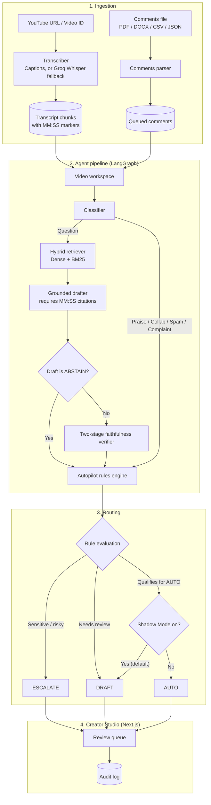
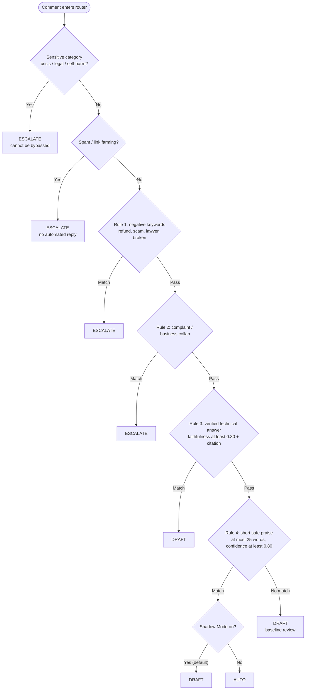

# CommentIQ

**A human-supervised AI agent that triages YouTube comments, answers technical questions only when the video transcript supports it, and escalates anything risky to the creator.**

[](https://www.python.org/downloads/)
[](https://fastapi.tiangolo.com/)
[](https://nextjs.org/)
[](https://langchain-ai.github.io/langgraph/)
[](#testing)
[](./LICENSE)


<details>
<summary>More screenshots</summary>


</details>

---

## Table of Contents

1. [The Problem](#the-problem)
2. [What It Does](#what-it-does)
3. [Architecture](#architecture)
4. [Features](#features)
5. [Evaluation](#evaluation)
6. [Limitations](#limitations)
7. [Tech Stack and Cost](#tech-stack-and-cost)
8. [Quickstart](#quickstart)
9. [Usage Walkthrough](#usage-walkthrough)
10. [Testing](#testing)
11. [Project Structure](#project-structure)
12. [Roadmap](#roadmap)
13. [License](#license)

---

## The Problem

Creators of technical channels get hundreds of comments per video. Most are praise, some are real questions the video already answers, and a few are complaints, business inquiries or sensitive messages that need a human. Letting an LLM reply to everything is risky: it may invent answers to questions the video never covered, or respond badly to a complaint.

CommentIQ is built around one idea: **the LLM drafts, but deterministic rules decide what happens next.**

## What It Does

Every comment is classified and routed to exactly one of three outcomes:

| Outcome | Meaning | Examples |
| :--- | :--- | :--- |
| 🟢 **AUTO** | Reply is published automatically (only if Shadow Mode is off) | Short, safe praise |
| 🔵 **DRAFT** | Held in a review queue for one-click approve / edit / reject | Grounded technical answers, anything uncertain |
| 🟠 **ESCALATE** | Flagged for the creator's personal attention, no automated reply | Complaints, bug reports, business/collab requests, spam, safety or legal issues |

Technical questions are answered **only** with evidence from the video transcript, cited as `[MM:SS]` timestamps. If the transcript does not support an answer, the system abstains instead of guessing.

**Shadow Mode is on by default.** Even comments that qualify for AUTO are held as drafts until the creator explicitly turns it off.

---

## Architecture

### End-to-end pipeline



### Routing logic and safety invariants



**Hard invariants** (enforced in code, not in prompts):
- Sensitive and spam categories are always escalated, whatever any rule says.
- Verified technical answers are always DRAFT, never AUTO. Only short praise can reach AUTO.
- With Shadow Mode on, nothing is auto-published.

### Retrieval

1. **Transcript source:** captions via `youtube-transcript-api` (tier 1), or audio via `yt-dlp` transcribed by Groq Whisper (tier 2) when captions are unavailable.
2. **Chunking:** 200-400 words per chunk, each prefixed with `[MM:SS]` markers.
3. **Search:** dense embeddings (`all-MiniLM-L6-v2`, 384d, local CPU) combined with BM25 lexical search using **weighted score fusion** (0.5 dense + 0.5 BM25).
4. **Isolation:** the vector store is scoped strictly by `video_id`, so answers never cite another video.

### Faithfulness verification

1. **Stage 1 (local, free):** a CPU overlap check between the draft and the retrieved chunks. Clear passes and clear failures are decided here.
2. **Stage 2 (LLM judge):** only borderline cases go to a Mistral judge model.

---

## Features

### Ingestion
- Accepts `youtube.com/watch?v=`, `youtu.be/`, shorts, embeds, or a raw 11-character video ID.
- Video title and author via oEmbed (no API quota).
- Comments are uploaded as PDF, DOCX, CSV or JSON.
- Transcripts can also be ingested standalone, before any comments are uploaded.

### Workspaces
- Named workspaces per video, course or playlist, each with its own transcript chunks and citations.
- Sidebar switcher with a global aggregate queue and live count badges.

### Autopilot rules engine
- Custom rules with: category match, confidence threshold, faithfulness threshold, retrieval similarity threshold, required citation, max word count, negative keywords, keyword triggers, VIP author matching, and priority ordering.
- **Dry-run simulator:** test a hypothetical comment and see which rule fires, the resulting action, and the reasoning trace.
- Four factory-default safety rules are pre-seeded.

### Creator persona (tone cloner)
- Extracts greeting habits, sign-offs, formality, emoji frequency and sentence length from the creator's real replies.
- One-click clone from previously approved replies in the database.
- Injects real `{comment, reply}` pairs into the drafter prompt as few-shot examples.
- **Grounding invariant:** the persona shapes voice and presentation only. Facts and citations always come from the transcript.
- Voice sandbox for testing a persona on sample comments, and a "Voice" label in the review drawer.

### Ask AI assistant
- Generates grounded sample replies from inside the review drawer.
- Shows a deterministic de-escalation notice when a comment touches safety, harassment, legal disputes or crisis.

### Creator Studio UI
- Dark-first, dense review queue built with Next.js 14, Geist fonts and Framer Motion.
- Keyboard-driven: `J`/`K` navigate, `Enter` opens the drawer, `A` approve, `E` edit, `R` reject, `Cmd/Ctrl+K` command palette.
- Immutable audit log of every action.

---

## Evaluation

> **Read this first:** the dataset was written by the author, is small, and the baselines are simple systems built for comparison. Treat these results as a development benchmark, not a general claim. See [EVALUATION.md](./EVALUATION.md) for methodology.

**Setup:** 100 hand-labeled comments across 7 intent classes, evaluated against two baselines implemented in `eval/baselines.py`:
- **Baseline A:** LLM with no retrieved context.
- **Baseline B:** naive RAG (retrieval plus an LLM, no abstention or verification).

### Unanswerable questions (n = 15)

Questions about topics the video does not cover (for example, asking about AWS Lambda in a Docker tutorial).

| System | Abstained | Hallucinated | Hallucination rate |
| :--- | :---: | :---: | :---: |
| Baseline A (no context) | 0 / 15 | 15 / 15 | 100% |
| Baseline B (naive RAG) | 0 / 15 | 15 / 15 | 100% |
| **CommentIQ** | **13 / 15** | **2 / 15** | **13.3%** |

### Classification and escalation (n = 100)

| Metric | Result |
| :--- | :---: |
| Accuracy | 90.0% |
| Macro F1 | 88.1% |
| Escalation recall | 97.1% (per-class counts in [EVALUATION.md](./EVALUATION.md)) |
| High-stakes comments auto-published | 0 (measured with Shadow Mode on) |

### Latency

| Metric | What it covers | Result |
| :--- | :--- | :---: |
| p50 | Cached and non-question path: regex routing, LangGraph state execution, SHA-256 cache hits | 13.5 ms |
| p95 | Full local CPU retrieval pipeline: 384d MiniLM embedding, BM25 ranking, score fusion, citation verification | 56.0 ms |

These figures measure **local compute only**. They exclude network calls to the LLM providers (classification, drafting, LLM judge), which add provider-dependent latency of typically hundreds of milliseconds to seconds on a cache miss. End-to-end uncached latency has not been benchmarked yet (see [Roadmap](#roadmap)).

### Caveats

- 15 unanswerable questions is too few for statistical claims. The result is directional.
- Baselines A and B have no abstention instruction, so a 100% hallucination rate is expected. A stronger comparison would add a naive RAG baseline prompted to say "I don't know" when the context lacks the answer.
- The dataset author is also the system author, which risks tuning the system to its own assumptions.
- "0 auto-published high-stakes replies" is guaranteed by design while Shadow Mode is on.

---

## Limitations

- **Unofficial transcript sources.** `youtube-transcript-api` and `yt-dlp` are not official YouTube APIs, can break without notice, and their use may conflict with YouTube's Terms of Service. Use them for personal and educational purposes.
- **Publishing quota.** Posting replies through the YouTube Data API consumes quota (a comment insert costs about 50 units against a default of 10,000 per day), which limits throughput.
- **Free-tier rate limits.** Groq and Mistral free tiers are rate-limited and their terms change, so heavy use needs a paid tier or a local model (Ollama).
- **English-centric.** The classifier, retriever and prompts have only been evaluated on English comments.
- **Transcript quality.** Auto-generated captions contain errors, and answers inherit them.
- **Small evaluation set.** See [Evaluation](#evaluation).

---

## Tech Stack and Cost

The project runs on free tiers and local compute. Quotas and model names change often, so check each provider's console.

| Component | Technology |
| :--- | :--- |
| Orchestration | LangGraph |
| Backend | FastAPI, SQLAlchemy, Pydantic |
| Frontend | Next.js 14, TypeScript, Framer Motion |
| Classifier / Drafter | Groq (Llama 3.3 70B, or gpt-oss models) |
| Verifier judge | Mistral (model name set in `backend/config/llm_config.yaml`) |
| Audio fallback | Groq Whisper Large-v3 |
| Captions | `youtube-transcript-api` |
| Embeddings | `sentence-transformers/all-MiniLM-L6-v2` (local CPU) |
| Lexical search | `rank-bm25` |
| Database | SQLite by default, PostgreSQL + pgvector optional |
| Prompt cache | SHA-256 keyed cache in the database |

---

## Quickstart

**Prerequisites:** Python 3.10+, Node.js 18+, and optionally Docker for PostgreSQL + pgvector.

### 1. Clone and configure

```bash
git clone https://github.com/Vixhal17/CommentIQ.git
cd CommentIQ
cp .env.example .env
```

Edit `.env`:

```env
GROQ_API_KEY=gsk_...        # https://console.groq.com/keys
MISTRAL_API_KEY=...         # https://console.mistral.ai/

SHADOW_MODE=true            # keep AUTO decisions as drafts
AUTO_PUBLISH_ENABLED=false
DATABASE_URL=sqlite:///./test.db
```

### 2. Start the backend

```bash
pip install -r backend/requirements.txt
python -m uvicorn backend.app.main:app --host 127.0.0.1 --port 8000
```

API docs: http://127.0.0.1:8000/docs

### 3. Start the frontend

```bash
cd frontend
npm install
npm run dev
```

Open http://localhost:3000.

---

## Usage Walkthrough

1. **Ingest.** Click **Upload & Triage** (or press `Cmd/Ctrl+K` and type "Upload"). Pick or create a workspace, add the video via YouTube URL (or upload a `.docx` / `.pdf` / `.txt` reference), upload your comments file, and start triage.
2. **Review.** Navigate with `J`/`K`, press `Enter` to open a comment, check the citation chips (for example `[04:12]`) and faithfulness score, then press `A` to approve, `E` to edit or `R` to reject.
3. **Tune the autopilot.** Open **Autopilot Rules**, adjust thresholds and negative keywords, and use the **Dry-Run Simulator** to see how a sample comment would be routed.

---

## Testing

```bash
python -m pytest backend/tests -v
```

52 tests cover ingestion, retrieval, verification, the rules engine, safety invariants and API endpoints.

To reproduce the benchmark:

```bash
python eval/run_eval.py
```

---

## Project Structure

```text
CommentIQ/
├── backend/
│   ├── app/
│   │   ├── agent/            # LangGraph graph, nodes, prompts, preferences
│   │   ├── api/              # FastAPI routes and Pydantic schemas
│   │   ├── core/             # Encryption and structured logging
│   │   ├── db/               # SQLAlchemy models and session handling
│   │   ├── ingestion/        # Document parsers, YouTube transcriber, OAuth
│   │   ├── llm/              # Resilient LLM client and cache
│   │   ├── retrieval/        # Embeddings and hybrid search
│   │   └── safety/           # Router, rules engine, faithfulness verifier
│   ├── config/               # Settings and llm_config.yaml
│   └── tests/                # 52 pytest tests
├── frontend/
│   └── src/
│       ├── app/              # Next.js App Router
│       ├── components/       # QueueTable, DetailDrawer, StatsBar, modals
│       └── types/
├── eval/                     # dataset.csv, baselines.py, run_eval.py
├── data/                     # Sample transcripts and comment files
├── docker-compose.yml        # PostgreSQL + pgvector
├── EVALUATION.md             # Detailed benchmark report
└── .env.example
```

---

## Roadmap

- [x] **Batch 1:** YouTube URL ingestion with Groq Whisper fallback
- [x] **Batch 2:** Autopilot rules engine with dry-run simulator
- [x] **Batch 3:** Creator persona tone cloner with few-shot drafting
- [ ] **Batch 4:** Audience insights and knowledge-gap detector
- [ ] Stronger evaluation: larger dataset, independently labeled, abstention-prompted RAG baseline
- [ ] Measured uncached end-to-end latency

---

## License

Released under the [MIT License](./LICENSE).
